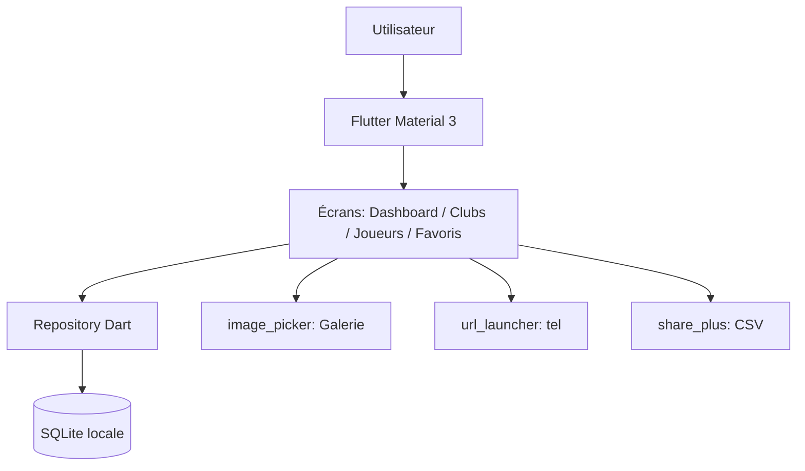
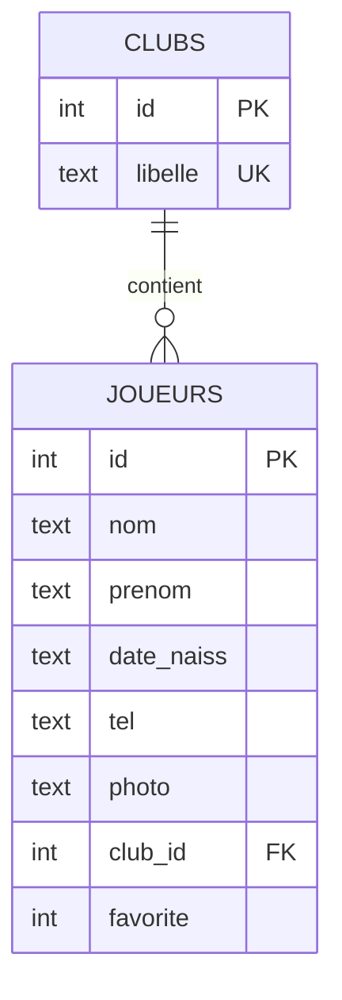

# Architecture — Championnat Pro

## Objectif
Application Flutter offline-first de gestion de championnat, en français, pensée pour une démonstration académique sur Android et Windows.

## Architecture logique

Aucun backend ni serveur SQLite externe n'est nécessaire. SQLite est embarquée dans l'application, et chaque installation possède sa propre base.

## Modèle relationnel

La clé étrangère `joueurs.club_id` interdit de supprimer un club ayant encore des joueurs. `libelle` est unique sans distinction de casse. `favorite` est stocké comme 0 ou 1.

## Scénario de démo (5 minutes)
1. Tableau de bord : vérifier les trois indicateurs et les effectifs des clubs.
2. Clubs : ajouter « Club Démo », modifier le libellé, ouvrir son effectif.
3. Joueurs : ajouter un joueur, renseigner date de naissance, numéro, photo, et club.
4. Recherche : filtrer par prénom, puis numéro, puis club ; transférer un joueur vers un autre club.
5. Favoris : marquer un joueur comme favori et ouvrir l'écran Favoris.
6. Export : partager les données en CSV et vérifier dans Excel.
7. Persistance : fermer et rouvrir l'application ; les données sont inchangées.
8. Intégrité : essayer de supprimer un club contenant un joueur — opération bloquée.

## Limites documentées
- Appels : nécessitent une application de téléphonie ; sur Windows ou émulateur, le composeur peut être absent.
- Photos : conservées localement dans l'espace Documents de l'application.
- Export CSV : ouvre le panneau de partage du système ; aucune sauvegarde cloud automatique.
- Jeu de données de démonstration : clubs et joueurs fictifs initialisés une seule fois.
- Les fichiers de plateforme Android/Windows sont générés localement avec `flutter create .`.
- Toute modification de schéma SQLite nécessitera une migration de version de base.

## Validation
La CI exécute `flutter analyze`, `flutter test` et `flutter build apk --debug`. Vérifier également le parcours manuel Android. Le succès de CI ne garantit pas le comportement du composeur ou de la galerie sur tous les appareils.
